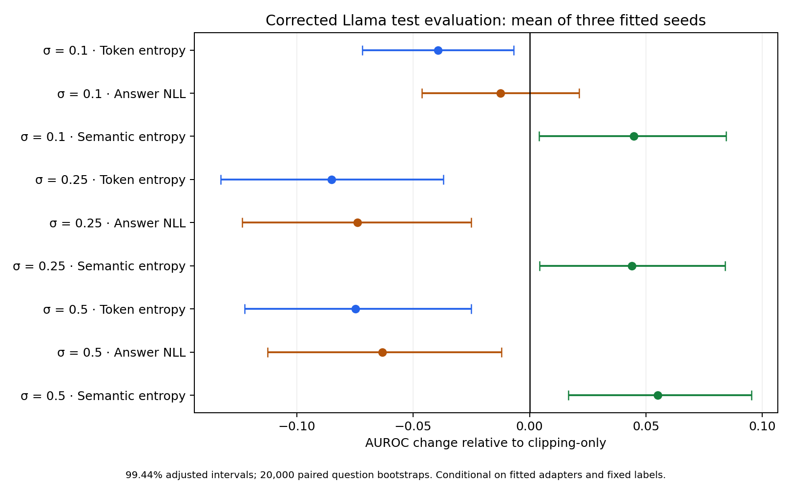

# Uncertainty Quantification under Noisy Fine-Tuning

OFYP research by Wonyeong Yoon investigating how clipping and
Gaussian noise during Llama-3.1-8B LoRA fine-tuning affect
uncertainty-based error detection and selective answering
on short-form factual questions.

## Experiments

- Conditions: standard fine-tuning, clipping only, and noise
  multipliers of 0.1, 0.25, and 0.5.
- Seeds: 123, 456, and 789.
- Uncertainty scores: token entropy, answer negative
  log-likelihood (NLL), and semantic entropy.
- Evaluation: answer accuracy, error-detection AUROC,
  and selective-answering risk and coverage.

Noise multipliers describe the training conditions; they are
not privacy-budget values.

## Repository contents

| Location | Contents |
|---|---|
| `notebooks/01_train.ipynb` | Low-noise training experiments |
| `notebooks/02_evaluate_dev.ipynb` | Development-set uncertainty evaluation |
| `notebooks/03_evaluate_test.ipynb` | Held-out test workflow and reporting |
| `notebooks/USAGE.md` | Notebook setup and execution limitations |
| `final_test_analysis_corrected/` | Main results, analysis script, and figure |
| `rq3_test_analysis/` | Selective-answering results and analysis |
| `training_records/` | Training configurations and summaries |
| `upload/` | Saved test-report bundles |
| `llama_test*_human_reviewed/` | Reviewed answer files used by the analyses |

## Results

See the [main results](final_test_analysis_corrected/report.md)
and [selective-answering results](rq3_test_analysis/report.md).



## Reproduce the saved-result analyses

Run from the repository root:

```bash
pip install -r requirements-analysis.txt
python final_test_analysis_corrected/analyze.py
python rq3_test_analysis/analyze.py
```

These analyses use the included report bundles and reviewed
answer files. No GPU is required.

## Running the notebooks

Read `notebooks/USAGE.md` first. Training and model inference
require a separate GPU environment and access to Llama-3.1-8B.

The supplied notebooks select seed 789; change the configuration
deliberately for other seeds. The test notebook includes an
analysis-only workflow that requires existing caches and should
not be run blindly with “Run all”.

## Limitations

The repository supports reproduction of the saved statistical
analyses, rather than guaranteed identical retraining.
Human review is partial, and some judgments are reused across
seeds. Results are specific to the evaluated model, dataset,
and experimental settings.